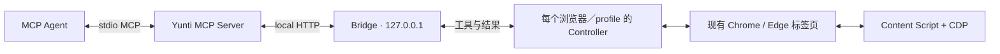

<div align="center">

# Yunti Browser Runtime

**让 AI Agent 操作你本机已登录的 Chrome / Edge。**

本地 Bridge · 标准 MCP · Content Script + CDP · 无需 Yunti 平台账号

[](https://github.com/BoCodeLab/yunti-browser-runtime/releases/latest)
[](package.json)
[](docs/TOOL_GUIDE.md)
[](LICENSE)

[快速开始](#快速开始) · [更新](#更新) · [交给-agent-安装或更新](#交给-agent-安装或更新) · [安全与隐私](#安全与隐私) · [开发与验证](#开发与验证) · [文档](#文档)

</div>

Yunti 把 Codex、Claude Code、Cursor、Cline 等 MCP Agent 连接到本机浏览器。
Agent 可以读取页面、定位元素、填写表单、管理标签页，并通过截图、网络和控制台诊断验证结果。
你可以继续使用自己的浏览器与登录状态，运行时不要求把会话复制到远程浏览器。

> English: A local MCP runtime for AI agents to inspect and operate existing
> Chrome / Edge sessions, with DOM actions, CDP, explicit routing, and verifiable results.

| 能力 | 行为 |
| --- | --- |
| 页面观察 | 可交互 DOM、轻量快照、完整快照、同源 iframe、开放 Shadow DOM |
| 元素操作 | 点击、输入、选择、按键、滚动、拖拽、上传；使用最新观察中的 uid |
| 浏览器管理 | 多浏览器与多 profile、标签页创建／切换／关闭、导航、设备仿真 |
| 结果验证 | 页面状态、截图、网络请求、控制台、性能 trace、下载记录 |
| 动态页面恢复 | 保留节点身份、检查可操作性、恢复页面路由、处理睡眠标签页 |
| 失败契约 | 明确错误码、共享重试预算；不确定的写操作要求先核对页面状态 |

## 当前版本与实测

GitHub 最新发布版为 [v0.2.9](https://github.com/BoCodeLab/yunti-browser-runtime/releases/tag/v0.2.9)。
本版本提供 54 个工具，包含超长结果分块读取、下载落点与状态报告，以及 UID、
诊断路由、超时预算和结果完整性修复。升级时请留意新增的 `downloads` 权限。

2026-10-15 对当前工作区源码完成了独立 Chromium 端到端耐久验收：

| 验收项 | 实测结果 |
| --- | --- |
| 连续运行 | 900.889 秒，708 个完整循环 |
| 工具覆盖 | 54 / 54 |
| 工具调用 | 18,902 / 18,902 成功 |
| 写入验证 | 服务端接受 708 次，重复写入 0 次 |
| 耗时 P50 / P95 / P99 / 最长 | 9 / 312 / 444 / 2,101 毫秒 |
| 恢复验证 | 708 次过期路由恢复、237 次子标签页创建关闭、178 次 CDP 重连 |
| 完整回归 | 305 通过、0 失败、0 跳过 |

测试使用 Chromium 153.0.8010.12、临时 profile、独立 Bridge 和本地模拟页面。
这些数据对应本次验证的源码，不是所有网站或既有发布 tag 的性能承诺。
通过标准和复现方式见[耐久测试](docs/SOAK_TEST.md)，记录见[项目状态](docs/PROJECT_STATUS.md)。

## 快速开始

需要 **Node.js 22+**、Git，以及 Chrome 或 Edge。当前推荐从 GitHub 源码安装。

### 1. 获取源码

在你选择的固定目录执行：

```bash
git clone https://github.com/BoCodeLab/yunti-browser-runtime.git
cd yunti-browser-runtime
git checkout v0.2.9
```

希望跟随开发版时可保留 `main`；发布 tag 提供固定版本。
没有 Git 也可以从 [Releases](https://github.com/BoCodeLab/yunti-browser-runtime/releases)
下载对应版本的 `Source code (zip)`，解压到固定目录。

运行时没有第三方运行依赖，日常使用可以跳过 `npm install`。
开发和真实浏览器测试需要安装开发依赖，见[开发与验证](#开发与验证)。
源码安装不会注册全局命令，下列 Node 命令可直接用于 PowerShell、cmd、macOS 和 Linux。

### 2. 接入 Agent，并安装 skill

以 Codex 为例，在仓库目录执行：

```bash
node scripts/print-config.js --agent codex --human
node scripts/install-skill.js --harness codex
```

按输出将 MCP server 接入你的 Agent，然后新建或重载 Agent 会话。
MCP server 会自动启动本地 Bridge，通常无需另开 `bridge` 进程。

`--agent` 支持 `codex`、`claude-code`、`cursor`、`cline`；skill 安装还支持 `dsh`，
其他工具可用 `--dest <技能目录>` 指定位置。目标已存在时先确认需要更新，再加 `--force`。
不要遗漏 packaged skill 的安装或接入；它提供页面路由、共享重试预算和操作后验证规范。

不同 Agent 的配置格式和接入位置见[安装指南](docs/INSTALL.md)。

### 3. 加载浏览器扩展

1. 打开 `chrome://extensions` 或 `edge://extensions`。
2. 开启开发者模式，选择“加载已解压的扩展程序”。
3. 选择仓库中的 `extension` 目录，并确认浏览器列出的权限。

扩展使用 `debugger` 执行自动化与 CDP，`webRequest` 采集网络诊断，
`downloads` 读取下载记录。它不接管或重定向下载。完整权限见[安全说明](docs/SECURITY.md)。

### 4. 验证连接

```bash
npm run doctor
```

确认包、Bridge、扩展版本一致，controller 在线，并检查已安装 skill 是否与源码一致。
再让 Agent 执行一次只读验证：

```text
yunti_get_tool_usage_hints → yunti_list_browser_targets
→ 选择目标页面 → yunti_get_page_snapshot 或 yunti_observe_page
```

默认 Bridge 为 `http://127.0.0.1:48887`，本机模式不要求 token。
一般不需要打开 popup、保存设置或逐页刷新。

## 更新

更新包含三部分：**磁盘源码、MCP server／Bridge 进程、浏览器扩展**。

1. 运行 `npm run doctor`，记录当前包、Bridge、扩展和 skill 状态。
2. 更新同一个源码目录；Git 安装可执行下列命令，ZIP 安装则将新版本内容覆盖到原目录。
3. 更新已接入 Agent 的 skill；目标已存在时使用 `--force`。
4. 核对监听 Bridge 端口的进程及其完整命令行，确认是需要替换的旧 Yunti 进程后再结束它。
5. 在扩展管理页点击“重新加载”，再开启新的 Agent 会话。
6. 重新运行 doctor 和只读页面验证，确认新版本实际生效。

```bash
git fetch --tags origin
git checkout v0.2.9
node scripts/install-skill.js --harness codex --force
```

请先保留自己的本地改动。若已切换到发布 tag，处于 detached HEAD 是正常现象；
后续更新检出新的 tag 即可。运行时目录被移动后，需要重新生成 MCP 配置。
仅做日常更新无需重新安装开发依赖；要跑测试时按 lockfile 更新依赖。

## 交给 Agent 安装或更新

将下方提示词交给你正在使用的 Agent，它会先判断本机状态，再执行对应步骤。

<details>
<summary><strong>展开安装／更新提示词</strong></summary>

```text
请帮我安装或更新 Yunti Browser Runtime：
https://github.com/BoCodeLab/yunti-browser-runtime

先判断本机是否已经安装，并检查 Node.js 22+ 与 Git。读取项目安装指南和 packaged skill。

【首次安装】
1. 选择固定的运行时目录，克隆仓库并检出 GitHub 最新正式发布 tag；不要把 main 当成稳定 tag。
   没有 Git 时，使用对应 Release 的 Source code (zip)。不要把仓库放进临时目录。
2. 日常运行不需要第三方依赖；只有开发和浏览器测试才安装开发依赖。
3. 在仓库目录运行 node scripts/print-config.js --agent <名称> --human，
   将 MCP server 配置接入我当前使用的 Agent。
4. 运行 node scripts/install-skill.js --harness <名称> 安装配套 skill。
   不支持的 Agent 用 --dest <技能目录>，或接入 SKILL.md 内容。已存在的目标先核对再覆盖。
5. MCP server 会自动启动 Bridge。引导我在浏览器扩展管理页开启开发者模式，
   加载仓库中的 extension 目录，并说明 debugger、webRequest、downloads 等权限用途。

【更新】
1. 先运行 npm run doctor，记录包、Bridge、扩展、已安装 skill 的状态。
2. 保存本地改动；Git 安装 fetch tags 后检出最新正式发布 tag，ZIP 安装覆盖到原目录。
   不要误加一层目录，MCP 配置引用的是原安装目录。
3. 找出旧 Bridge 的 PID、完整命令行和安装目录；确认确属待更新的 Yunti 进程后再结束它。
   不要批量终止端口上的进程，也不要误停其他 Agent。
4. 更新我已接入的 skill；使用 node scripts/install-skill.js --harness <名称> --force。
5. 引导我重新加载浏览器扩展，并说明新增权限，再开启新的 Agent 会话。

【最后验收】
- 运行 npm run doctor，确认包／Bridge／扩展版本一致、controller 在线、skill 没有差异。
- 先读取 yunti_get_tool_usage_hints，再列出 targets，选择页面做一次只读观察并验证内容。
- 操作我的页面前说明可读取的数据、截图和原始 CDP 的敏感信息边界，以及当前 Agent 的模型／日志去向。
- 默认 Bridge 仅监听 127.0.0.1:48887，本地不需要 token；无需默认打开 popup 或刷新页面。
- 页面异常时读取结构化 recoveryAction 与共享预算，先自动恢复；仍无法恢复再说明证据。
- 最后报告实际生效版本、已验证项和待处理项；不要把文件更新成功当成运行时已生效。
```

</details>

## 工作原理



页面操作遵循 **观察 → 使用最新 uid 操作 → 等待／再次观察 → 验证结果**。
多步操作可以使用 inventory 返回的 `pageHandleId`；元素 uid 仍只属于产生它的那次观察。
跨域 iframe、Canvas、浏览器 targets 或精确输入等场景可使用 CDP。

失败时读取 `code`、`retryable`、`retryBudget`、`recoveryAction` 和 `resultUncertain`。
整个恢复链共享一个预算；可能已完成的写操作先核对状态，再决定下一步。
Edge 睡眠标签页会尝试有界恢复，Agent 不应默认要求用户刷新、切换标签或重启浏览器。

[查看全部 54 个工具、参数与用例](docs/TOOL_GUIDE.md) ·
[查看 Agent 工作流契约](docs/AGENT_WORKFLOW_CONTRACT.md)

## 安全与隐私

Yunti 默认使用本机 Bridge，不依赖项目托管的云端中继或平台账号。
**工具结果会交给你接入的 Agent；其模型服务、遥测和日志是否上传数据，由该 Agent 的配置决定。**

| 数据 | 默认处理与边界 |
| --- | --- |
| DOM 观察 | 默认 `balanced` 脱敏；需要隐藏更多个人信息时使用 `strict` |
| 网络与控制台诊断 | 使用脱敏规则过滤敏感字段与常见凭据；规则无法保证识别所有秘密 |
| 截图 | 返回真实页面像素，可能包含账号、消息或其他敏感内容 |
| 原始 CDP、脚本求值、trace | 可能返回未脱敏内容；按需使用，分享前检查，调试后清理缓冲 |
| 下载记录 | 包含本地文件路径与下载状态；来源 URL 去除查询串；不读取下载文件内容 |
| 学习记忆 | 写入本机 Yunti 数据目录；不要主动保存凭据或个人敏感资料 |
| 操作台账 | 默认关闭；`YUNTI_BROWSER_LEDGER=1` 启用后仅保存调用元数据、参数键名与指纹 |

- Bridge 默认仅监听 `127.0.0.1`；设置 `YUNTI_BROWSER_BRIDGE_TOKEN` 可启用本地认证，
  绑定非 loopback 地址时必须提供 token。不要把 token 写进仓库或提交示例。
- 扩展有广泛的 HTTP／HTTPS 页面访问权限；只从可信源码加载，也可在 popup 配置页面匹配范围。
- 提交、删除、购买、发布、生产数据修改和敏感文件上传，应由 Agent 根据影响取得用户授权。
- 本地凭据、日志、截图、浏览器 profile 和测试产物应保留在 Git 忽略的目录中。

完整权限、脱敏范围和限制见[安全说明](docs/SECURITY.md)。

## 开发与验证

```bash
npm ci
npx playwright-core install chromium
```

运行真实浏览器测试前设置环境变量：

```powershell
# PowerShell
$env:YUNTI_E2E = "1"
```

```bash
# macOS / Linux
export YUNTI_E2E=1
```

随后运行：

```bash
npm run test:interactions
npm run test:e2e
npm run release:check
npm run test:soak
```

`release:check` 包含全套 `npm test`、语法、版本、文档链接与打包检查。
没有 `YUNTI_E2E=1` 时，`npm test` 会跳过真实浏览器文件；验收必须同时满足 **fail 0、skipped 0**。
耐久测试使用独立的可见 Chromium 窗口，至少连续运行 15 分钟；要求全部工具覆盖、
零失败、零重复写入、P95 ≤ 500 毫秒、单次最长 ≤ 10 秒。

开发测试脚本时可短跑，但不可作为正式验收证据：

```bash
node scripts/soak-test.js --duration-seconds=180 --allow-short
```

浏览器下载受网络限制时，参考[浏览器准备与手动安装](docs/SOAK_TEST.md)。
测试产物写入 `.artifacts/`，不要提交原始日志、截图或本机路径。

## 常见问题

<details>
<summary><strong>已加载扩展，为什么仍提示版本不一致？</strong></summary>

doctor 检查的是包、正在运行的 Bridge 和浏览器扩展三处版本。旧 Bridge 仍占用端口时，
新的 MCP server 可能代理到旧进程。核对 PID、命令行与安装目录后，仅结束对应的旧 Yunti
进程，再重载扩展、开启新 Agent 会话。不要按端口直接批量终止进程。

</details>

<details>
<summary><strong>页面不可操作或旧 session 失效怎么办？</strong></summary>

先读取结构化恢复字段，重新列出 targets，使用明确的页面路由并遵守返回的重试预算。
普通 HTTP／HTTPS 标签页支持自动路由恢复；浏览器内置页、其他扩展页和策略禁止访问的
页面有额外限制。页面超时本身不代表整个浏览器离线。

</details>

<details>
<summary><strong>PowerShell 下 npm 带参数命令报 Unknown cli flags？</strong></summary>

可以直接调用相同的 Node 入口，例如 `node scripts/print-config.js --agent codex --human`，
避免 shell 或 npm 版本对 `--` 的解析差异。无需全局安装 CLI。

</details>

## 文档

| 文档 | 内容 |
| --- | --- |
| [安装指南](docs/INSTALL.md) | Agent 接入、配置与故障恢复 |
| [工具指南](docs/TOOL_GUIDE.md) | 54 个工具、参数、路由与使用示例 |
| [Agent 工作流](docs/AGENT_WORKFLOW_CONTRACT.md) | 操作、验证、授权与恢复 |
| [稳定页面句柄](docs/STABLE_PAGE_HANDLE_PLAN.md) | 页面身份与生命周期契约 |
| [安全说明](docs/SECURITY.md) | 权限、数据处理与边界 |
| [耐久测试](docs/SOAK_TEST.md) | 本地复现、验收标准与产物 |
| [0.2.9 发布说明](docs/RELEASE_0_2_9.md) | 版本能力与兼容性变化 |
| [项目状态](docs/PROJECT_STATUS.md) | 实测证据与阶段进展 |
| [路线图](docs/ROADMAP.md) | 后续计划 |
| [发布手册](docs/RELEASE.md) | 构建、发布与发布后验证 |

## 参与项目

欢迎提交 [Issue](https://github.com/BoCodeLab/yunti-browser-runtime/issues) 和 Pull Request。
请附上版本、浏览器、复现步骤、预期结果和脱敏后的实际结果；不要公开访问令牌、
cookie、原始 CDP／网络载荷或带个人信息的截图。新增工具或行为变化请同步补充契约、
测试与耐久覆盖，提交前运行发布门禁。

详见[贡献指南](CONTRIBUTING.md)与[项目初衷](docs/PROJECT_INTENT.md)。

## License

[MIT](LICENSE)
